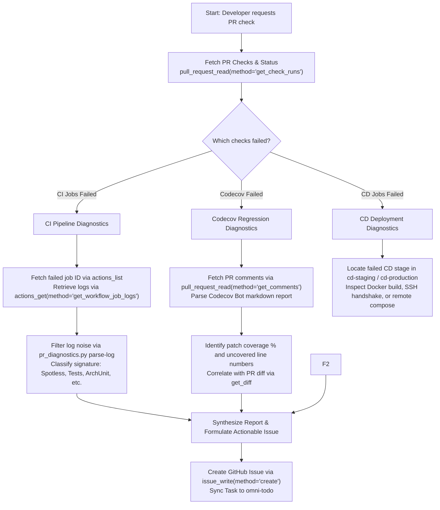

# GitHub MCP Skill - PR Diagnostics, CI/CD Monitoring & Issue Management

## 1. Overview & Purpose

This skill standardizes how coding agents interact with GitHub in the **ShareRide** monorepo using the official [GitHub MCP Server](https://github.com/github/github-mcp-server).

Its primary objectives are:
1. **Pull Request Failure Diagnostics**: Inspect and triage PR failures caused by **CI pipelines**, **Codecov coverage checks**, or **CD deployments**.
2. **Issue Creation & Tracking**: Formulate standardized, high-context GitHub issues from diagnostics, seamlessly synchronized with `omni-todo`.
3. **Repository Analysis & Code Search**: Support code inspection and commit verification without checking out separate trees.

---

## 2. STRICT GUARDRAILS & PROHIBITIONS (RED LINE)

> [!CAUTION]
> **PULL REQUEST CREATION AND DIRECT CODE PUSH ARE STRICTLY FORBIDDEN FOR AGENTS.**
> All Pull Requests must be authored, reviewed, and submitted manually by human developers.

### Prohibited Operations
| Prohibited Tool / Action | Reason |
| --- | --- |
| `create_pull_request` / `pull_request_write(method="create")` | **PROHIBITED**: Agents must never create Pull Requests. |
| `pull_request_write(method="merge")` / PR Merging | **PROHIBITED**: Agents must never merge Pull Requests. |
| `push_files` / Remote Git Push | **PROHIBITED**: Agents must never push commits or branches to remote repositories. |
| Destructive operations (`delete_*`, modifying repo settings) | **PROHIBITED**: Agents operate under read-mostly + issue tracking boundaries. |

### Allowed Operations
| Allowed Category | Permitted Tools |
| --- | --- |
| **Pull Request Inspection** (Read-Only) | `pull_request_read` (methods: `get`, `get_status`, `get_check_runs`, `get_comments`, `get_files`, `get_diff`, `get_reviews`, `get_commits`) |
| **Actions & CI/CD** (Read-Only) | `actions_list` (methods: `list_workflows`, `list_workflow_runs`, `list_workflow_jobs`, `list_workflow_run_artifacts`), `actions_get` (methods: `get_workflow_run`, `get_workflow_job`, `get_workflow_job_logs`, `get_workflow_run_logs`) |
| **Issue Management** (Write Permitted) | `issue_write` (methods: `create`, `update`), `issue_read`, `add_issue_comment`, `list_issues`, `search_issues` |
| **Repository Search** (Read-Only) | `search_code`, `get_file_contents`, `list_commits`, `get_commit` |

---

## 3. Configuration & Server Setup

The GitHub MCP Server is declared in `.mcp.json`:

```json
{
    "mcpServers": {
        "todo": {
            "type": "sse",
            "url": "http://127.0.0.1:20130/mcp/todo"
        },
        "github": {
            "type": "http",
            "url": "https://api.githubcopilot.com/mcp/"
        }
    }
}
```

### Tool Invocation Conventions
The official `github-mcp-server` supports both **Modern Consolidated Tools** and **Legacy Aliases** (via `deprecated_tool_aliases.go`):

| Modern Consolidated Tool | Method Parameter | Legacy Alias (Backward Compatible) |
| --- | --- | --- |
| `pull_request_read` | `method="get_check_runs"` | `list_check_runs_for_ref` |
| `pull_request_read` | `method="get_status"` | `get_combined_status_for_ref` |
| `pull_request_read` | `method="get_comments"` | `list_issue_comments` |
| `actions_list` | `method="list_workflow_runs"` | `list_workflow_runs` |
| `actions_list` | `method="list_workflow_jobs"` | `list_workflow_run_jobs` |
| `actions_get` | `method="get_workflow_job_logs"` | `get_workflow_run_job_logs` |
| `issue_write` | `method="create"` | `create_issue` |
| `issue_write` | `method="update"` | `update_issue` |
| `issue_read` | `method="get"` | `get_issue` |

*Default repository parameters in ShareRide:*
- `owner`: `"anhjkr"`
- `repo`: `"ShareRide"`

---

## 4. Pull Request Diagnostic Workflow (CI, Codecov, CD)

When a developer asks to inspect a Pull Request (e.g., *"Check why PR #12 is failing"*), execute this 3-tier diagnostic procedure:



---

### Step 1: Inspect PR Check Runs and Combined Status

First, inspect all check runs and commit statuses associated with the pull request:

```bash
# MCP Tool: pull_request_read
# Method: get_check_runs
# Parameters:
# - owner: "anhjkr"
# - repo: "ShareRide"
# - pull_number: 12
```

Also check the combined commit status (used by external status reporters):

```bash
# MCP Tool: pull_request_read
# Method: get_status
# Parameters:
# - owner: "anhjkr"
# - repo: "ShareRide"
# - pull_number: 12
```

Examine the `check_runs` output and classify any failures into one of three buckets:
1. **CI Pipeline Failures**: Job names containing `Code Quality`, `Unit Test`, `Integration Tests`, `Package`, or `CI Status Gate`.
2. **Codecov Failures**: Check names containing `codecov/patch` or `codecov/project`.
3. **CD Pipeline Failures**: Job names containing `deploy`, `staging`, `production`, `docker-build`, or `CD Status Gate`.

---

### Step 2A: Deep-Dive CI Pipeline Failures

The ShareRide CI workflow (`.github/workflows/ci.yml`) runs in four parallel and sequential stages:
1. `code-quality`: Spotless formatting (`spotless:check`) and Checkstyle rules (`checkstyle:check`).
2. `test-modules`: Matrix unit tests across modules (`common`, `notification-service`, `auth-service`, `service-template`, `gateway-service`).
3. `integration-test`: Testcontainers tests (`*IntegrationTest`) with PostgreSQL 17 and Valkey.
4. `package-and-verify`: Maven package without tests (`mvn package -DskipTests`).

#### 1. Retrieve the Failed Job Logs
Find the failed job ID from the check run or workflow run:

```bash
# MCP Tool: actions_list
# Method: list_workflow_jobs
# Parameters:
# - owner: "anhjkr"
# - repo: "ShareRide"
# - resource_id: "<WORKFLOW_RUN_ID>"
```

Then fetch the execution log for the failing job:

```bash
# MCP Tool: actions_get
# Method: get_workflow_job_logs
# Parameters:
# - owner: "anhjkr"
# - repo: "ShareRide"
# - resource_id: "<JOB_ID>"
```

#### 2. Extract Error Signatures (Eliminating Log Bloat)
CI logs contain thousands of lines of Maven download messages. Use the helper script to isolate the error slice:

```bash
python3 .agents/skills/github-mcp/scripts/pr_diagnostics.py parse-log -f /path/to/raw_job_log.txt
```

#### 3. Match Known Failure Signatures

- **Spotless Formatting Violation**:
  ```txt
  [ERROR] > The following files had format violations:
  [ERROR]   services/auth-service/src/.../AuthServiceImpl.java
  [ERROR] Run 'mvn spotless:apply' to fix these violations.
  ```
  *Remediation*: Run `mvn spotless:apply` and commit formatting changes.

- **Checkstyle Violation**:
  ```txt
  [ERROR] src/main/java/com/shareride/.../AuthController.java:[12,1] (imports) CustomImportOrder
  ```
  *Remediation*: Fix unused or out-of-order imports, re-verify with `mvn checkstyle:check`.

- **ArchUnit Architecture Rule Violation**:
  ```txt
  java.lang.AssertionError: Architecture Violation [Priority: MEDIUM]
  Rule 'Controllers should not depend on repositories directly' was violated (1 times):
  ```
  *Remediation*: Remove direct repository injection in Controller; inject `*Service` interface instead.

- **Unit Test Assertion Failure**:
  ```txt
  [ERROR] Failures: 
  [ERROR]   AuthServiceImplTest.testLogin_WithInvalidPassword_ShouldThrow:45 expected: <401> but was: <500>
  ```
  *Remediation*: Review recent commit changes affecting that test method.

- **Testcontainers / Integration Test Timeout**:
  ```txt
  org.testcontainers.containers.ContainerLaunchException: Timed out waiting for container port to open
  ```
  *Remediation*: Ensure class extends `AbstractIntegrationTest` with `@Testcontainers(disabledWithoutDocker = true)`.

---

### Step 2B: Deep-Dive Codecov Failures

ShareRide requires **minimum 80% patch coverage** on all new code added in Pull Requests.

#### 1. Inspect Codecov Status
Check if `codecov/patch` or `codecov/project` failed in `pull_request_read(method="get_check_runs")`.

#### 2. Retrieve Codecov Bot Report Comment
The Codecov bot automatically comments on the PR with detailed file-by-file metrics and uncovered line numbers:

```bash
# MCP Tool: pull_request_read
# Method: get_comments
# Parameters:
# - owner: "anhjkr"
# - repo: "ShareRide"
# - pull_number: 12
```

Locate the comment where `comment.user.login` is `codecov[bot]` or body contains `Codecov Report`.

#### 3. Parse Uncovered Lines
Extract the uncovered lines from the report table:
```markdown
| File | Coverage | Uncovered Lines |
| `auth-service/.../TokenProvider.java` | 60.0% | `45-52, 60` |
```

#### 4. Correlate with PR Diff
Fetch the diff to inspect what code was added at those lines:

```bash
# MCP Tool: pull_request_read
# Method: get_diff
# Parameters:
# - owner: "anhjkr"
# - repo: "ShareRide"
# - pull_number: 12
```

#### 5. Recommend Exact Unit Tests
Formulate concrete test scenarios to cover missing branches:
- Uncovered branch: `if (user.isBlocked()) throw new UserBlockedException();`
- Recommendation: Add unit test `testLogin_WhenUserIsBlocked_ShouldThrowUserBlockedException()` in `AuthServiceImplTest`.

---

### Step 2C: Deep-Dive Continuous Deployment (CD) Failures

CD pipelines (`cd-staging.yml` and `cd-production.yml`) deploy containerized microservices to remote environments.

#### Typical CD Failure Points:

1. **`verify-ci` Failure**:
   - Upstream CI pipeline did not pass on `staging` or `main`.
   - *Fix*: Resolve CI failures before attempting deployment.

2. **`build-and-push` Docker Build Failure**:
   - `mvnw package -pl <service> -am -DskipTests` failed or Dockerfile syntax error.
   - Docker Hub authentication failure (`401 Unauthorized`).
   - *Fix*: Check Dockerfile multi-stage build, verify `DOCKER_USERNAME` / `DOCKER_PASSWORD` secrets.

3. **`deploy-staging` / `deploy-production` SSH Failure**:
   - `Host key verification failed` or connection timeout on port 22.
   - Missing `SSH_HOST` or `SSH_PRIVATE_KEY` in environment secrets.
   - *Fix*: Check server availability and GitHub Environment secrets.

4. **Remote Docker Compose / Runtime Crash**:
   - Container fails health check `/actuator/health` due to missing database connection or secret mismatch (`VALKEY_PASSWORD`, `DB_PASSWORD`, `PASSWORD_PEPPER`).
   - *Fix*: Inspect remote container logs: `docker compose -f docker-compose.staging.yml logs <service>`.

---

## 5. Issue Management & omni-todo Integration

When a failure is diagnosed and needs resolution tracking, create a GitHub Issue and synchronize it with `omni-todo`.

### Step 1: Create GitHub Issue via MCP

Use `issue_write` (or legacy `create_issue`):

```bash
# MCP Tool: issue_write
# Method: "create"
# Parameters:
# - owner: "anhjkr"
# - repo: "ShareRide"
# - title: "[CI Failure] Spotless formatting violations in auth-service (PR #12)"
# - body: (Use standard markdown template from templates/ directory)
# - labels: ["bug", "ci-failure", "auth-service"]
```

### Step 2: Synchronize with omni-todo (Mandatory First Action Rule)

Per ShareRide guidelines in `AGENTS.md`, any medium-to-large task must be recorded and tracked via the `omni-todo` CLI:

```bash
omni-todo add \
  --title="Fix CI failure in auth-service on PR #12" \
  --description="GitHub Issue #45 - Spotless format violations" \
  --content="Run mvn spotless:apply and commit formatting fixes for AuthServiceImpl.java" \
  --tag="bug" \
  --tag="ci-cd" \
  --tag="auth-service"
```

Once the fix is ready and verified:
```bash
omni-todo set --id=<TASK_ID> --status=completed
```

And update the GitHub Issue with resolution details:
```bash
# MCP Tool: add_issue_comment
# Parameters:
# - owner: "anhjkr"
# - repo: "ShareRide"
# - issue_number: 45
# - body: "Fixed in commit abc123def. Re-run CI passed."

# MCP Tool: issue_write
# Method: "update"
# Parameters:
# - owner: "anhjkr"
# - repo: "ShareRide"
# - issue_number: 45
# - state: "closed"
```

---

## 6. Helper Script Reference (`scripts/pr_diagnostics.py`)

The skill includes a dedicated helper script located at `.agents/skills/github-mcp/scripts/pr_diagnostics.py`. It requires only Python standard libraries and can be executed directly in the workspace.

### Commands:

#### 1. Parse Raw Log File (Filter 95% Noise)
```bash
python3 .agents/skills/github-mcp/scripts/pr_diagnostics.py parse-log -f /path/to/log.txt --lines 50
```

#### 2. Triage PR from Check Runs and Comments
```bash
python3 .agents/skills/github-mcp/scripts/pr_diagnostics.py triage \
  --pr 12 \
  --title "feat: add user authentication" \
  --branch "feature/auth" \
  --checks-file /tmp/checks.json \
  --comments-file /tmp/comments.json \
  --log-file /tmp/failed_job.log
```

#### 3. Generate Issue JSON Payload
```bash
python3 .agents/skills/github-mcp/scripts/pr_diagnostics.py make-issue \
  --type ci \
  --pr 12 \
  --title "Spotless formatting violation in auth-service" \
  --summary "Code quality check failed due to unformatted files." \
  --log-file /tmp/failed_job.log \
  --service "auth-service"
```

---

## 7. Templates Reference

Standardized Markdown issue templates are maintained in `.agents/skills/github-mcp/templates/`:
- `templates/ci-failure-issue.md`: Template for CI pipeline failures (Spotless, Checkstyle, Tests, ArchUnit, Packaging).
- `templates/codecov-regression-issue.md`: Template for Codecov patch/project coverage shortfalls.
- `templates/cd-failure-issue.md`: Template for CD deployment failures (Docker, SSH, Compose, Migrations).

Detailed error signatures and remediation guides are in `.agents/skills/github-mcp/references/error-patterns.md`.

---

## 8. End-to-End Troubleshooting Scenarios

### Scenario A: PR CI Failure (ArchUnit Violation)
```txt
1. User: "PR #15 failed in CI, tell me what went wrong."
2. Agent calls pull_request_read(method="get_check_runs", pull_number=15).
   -> Sees job "Unit Test (auth-service)" conclusion: "failure".
3. Agent calls actions_list(method="list_workflow_jobs", resource_id=run_id).
   -> Gets job_id 882193.
4. Agent calls actions_get(method="get_workflow_job_logs", resource_id=882193).
5. Agent runs pr_diagnostics.py parse-log on the retrieved log:
   -> Detects: "Architecture Violation: Controllers should not depend on repositories directly".
6. Agent reports exact file, line, and architectural violation to user.
7. Agent asks or creates tracking issue using templates/ci-failure-issue.md.
8. Agent links issue to omni-todo.
```

### Scenario B: PR Codecov Coverage Regression
```txt
1. User: "Codecov check failed on PR #18."
2. Agent calls pull_request_read(method="get_check_runs", pull_number=18).
   -> Confirms "codecov/patch" status: failure (64.5% < 80.0%).
3. Agent calls pull_request_read(method="get_comments", pull_number=18).
   -> Locates Codecov bot comment.
4. Agent extracts uncovered lines:
   -> services/auth-service/.../AuthServiceImpl.java, lines 112-128 (password reset branch).
5. Agent calls pull_request_read(method="get_diff", pull_number=18) to inspect lines 112-128.
6. Agent recommends specific test cases: "testResetPassword_WhenTokenExpired_ShouldThrowException()".
7. Agent creates issue / reports actionable fix.
```

### Scenario C: CD Staging Deployment Failure
```txt
1. User: "Staging deployment failed after merge."
2. Agent calls actions_list(method="list_workflow_runs", branch="staging", event="push").
   -> Locates latest "Continuous Deployment - Staging" run.
3. Agent calls actions_list(method="list_workflow_jobs", resource_id=run_id).
   -> Identifies job "deploy-staging" failed at step "Deploy Containers on Staging Server".
4. Agent calls actions_get(method="get_workflow_job_logs", resource_id=job_id).
5. Agent isolates failure: "SSH connect to host 192.168.1.50 port 22: Connection timed out".
6. Agent creates CD failure issue with templates/cd-failure-issue.md and tags high-priority.
```

---

## 9. Best Practices Checklist

- [ ] **Always inspect logs before creating issues**: Never create an issue based solely on a high-level `failure` status string.
- [ ] **Filter log bloat**: Use `pr_diagnostics.py parse-log` to extract only the 30-50 lines surrounding the actual exception.
- [ ] **Never create Pull Requests**: Strictly leave PR creation and git pushes to developers.
- [ ] **Mandatory omni-todo sync**: When an issue is opened, immediately create or update the corresponding task in `omni-todo`.
- [ ] **Respect service isolation**: Ensure labels specify the affected microservice (`auth-service`, `gateway-service`, `notification-service`, `common`).
